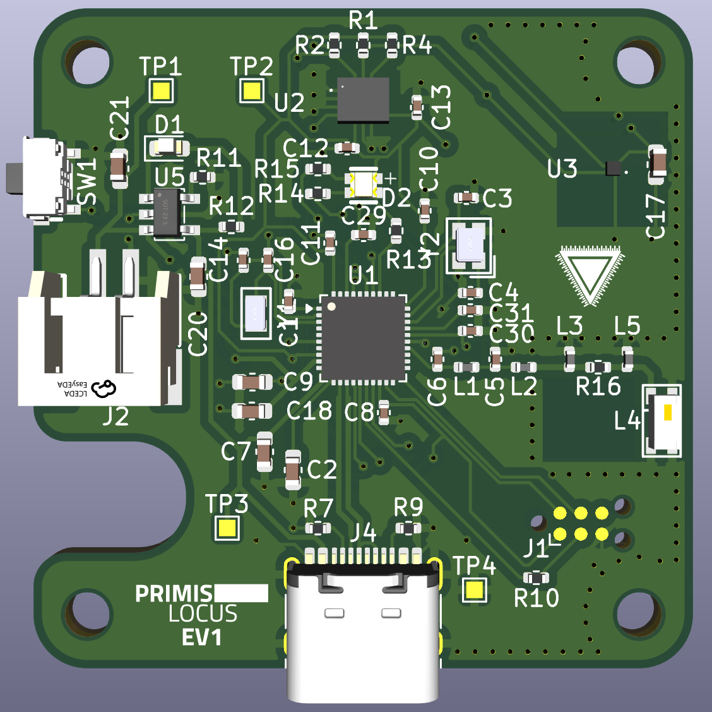
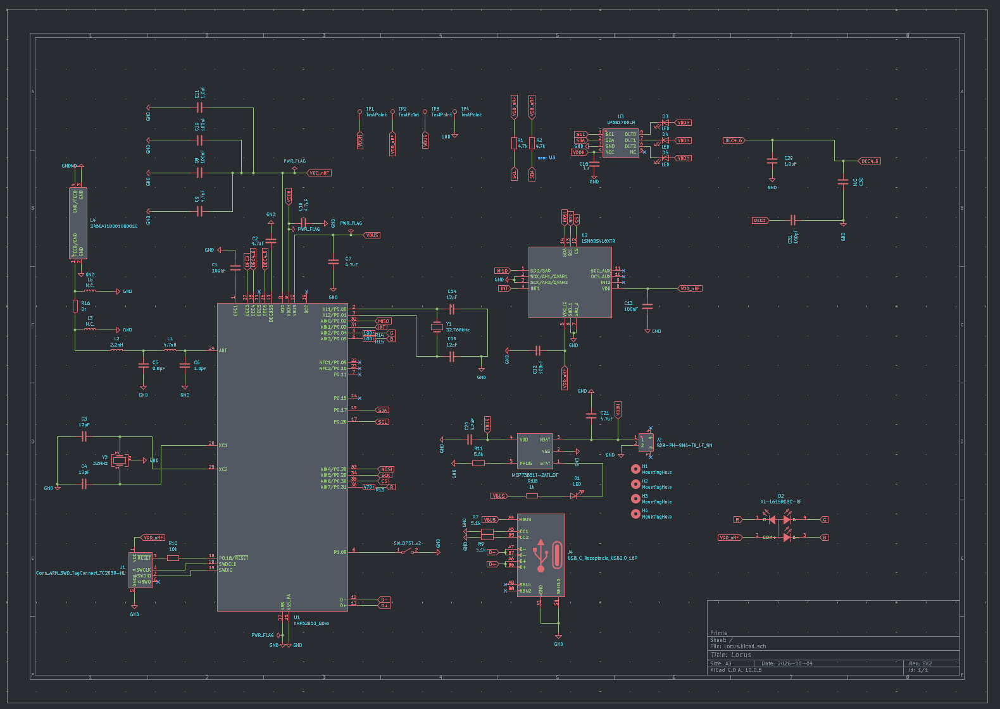
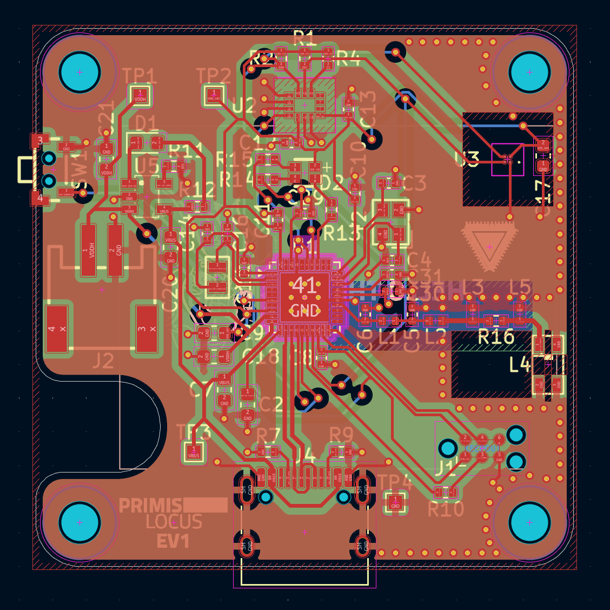
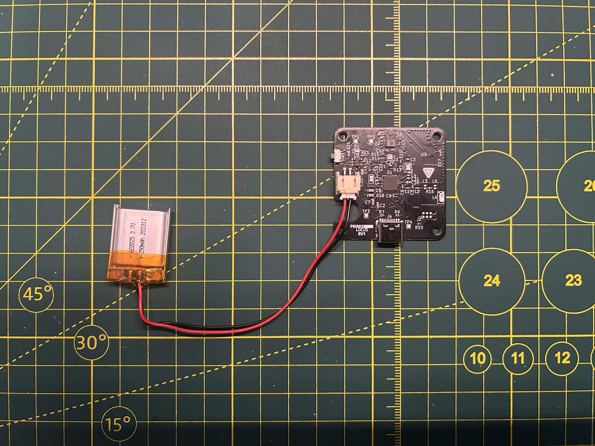

### Status

| 🛑R&D | hw: EV2 | 
| -------- | ------- |

> This accessory is experimental. The latest hardware revision is either untested, incomplete, or broken. Capabilities are unproven. Form factor and design requirements may change entirely. Intended for use by hardware contributors.

## Current Isseus
Currently the SDA line is getting pulled 0.02v while running the slime firmware, if I halt the NRF52833 it jumps up to the expected 1.8v. Currently working on figuring out why this happens.

  

### Schematics

  

### PCB

  

### EV1

  

