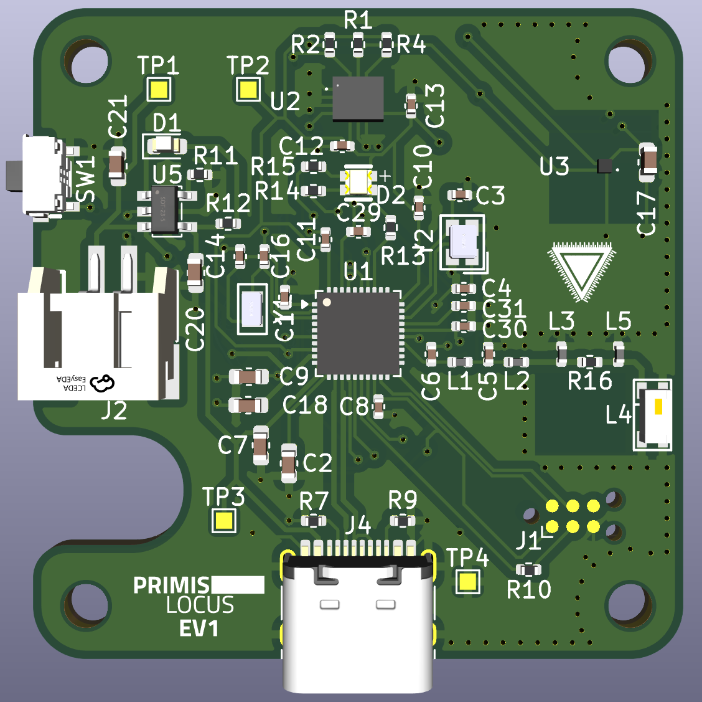
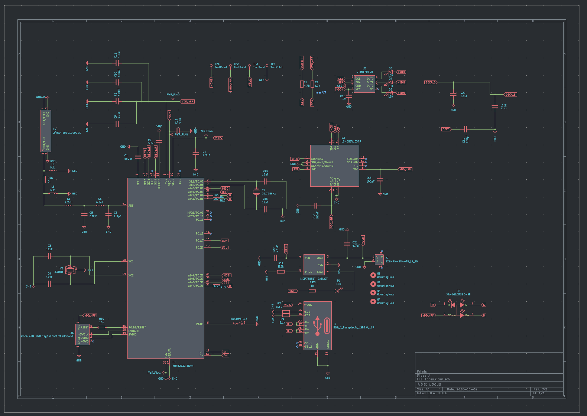
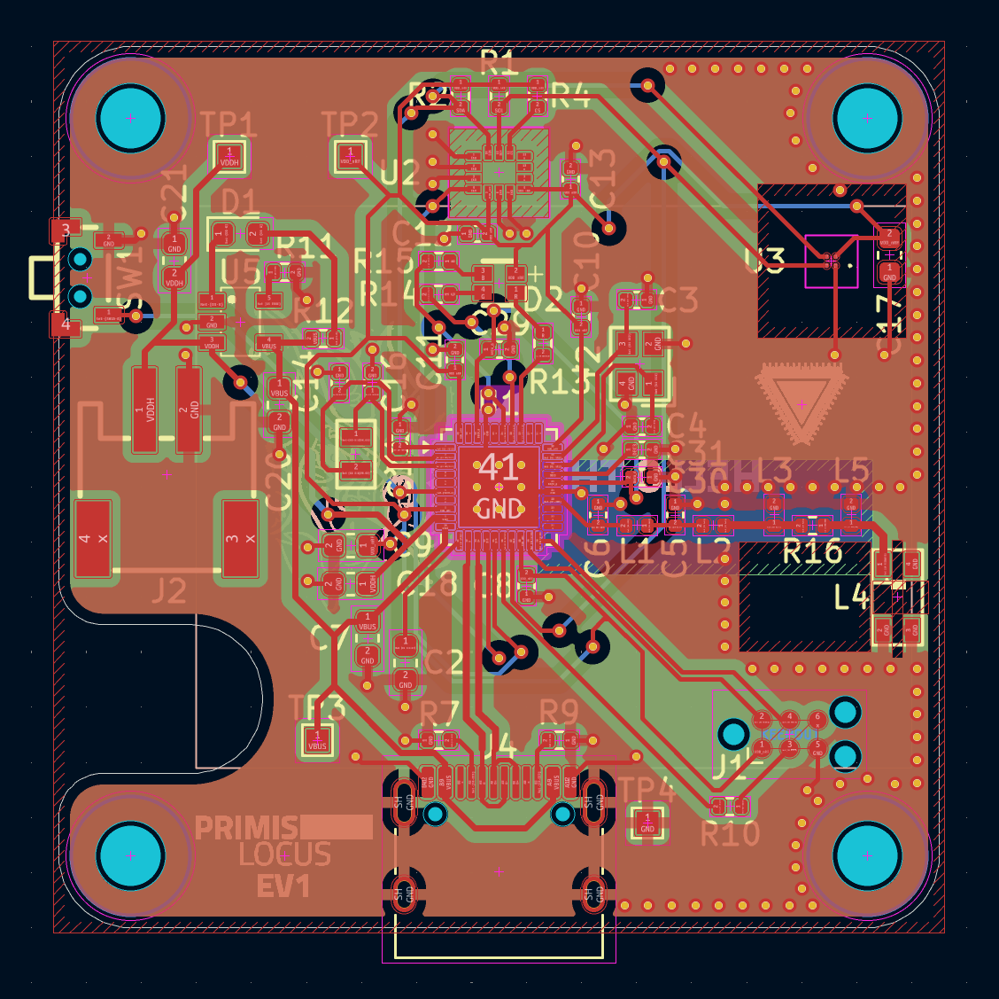
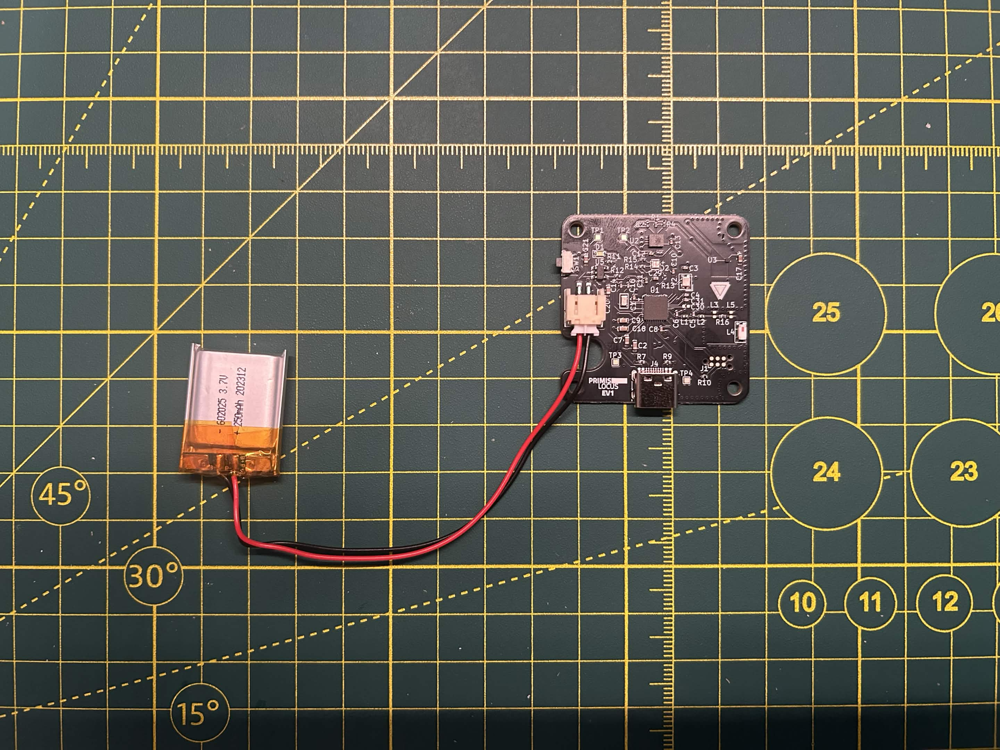
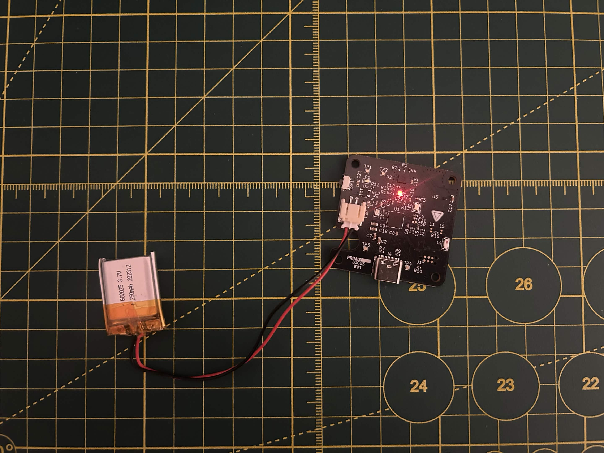

### Status

| 🟠WIP | hw: EV2 | 
| -------- | ------- |

> The current hardware revision has been tested and is fully capable of meeting established design requirements. Firmware and/or software are in active development. Future hardware revisions may still follow if oversights or improvements are discovered. Intended for use by software contributors.

  

### Schematics

  

### PCB

  

### EV1

  

### EV2

  

