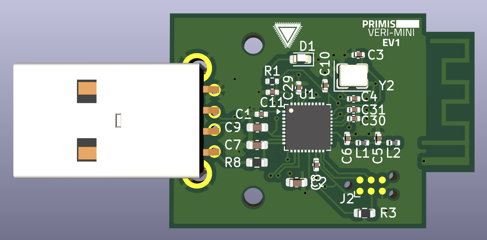
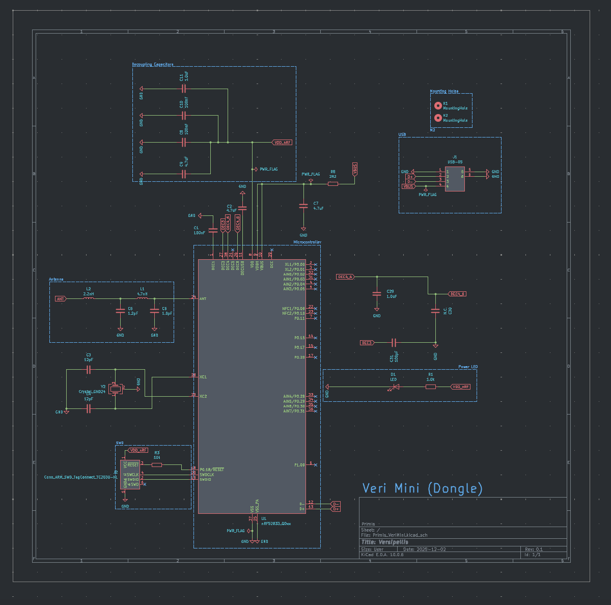
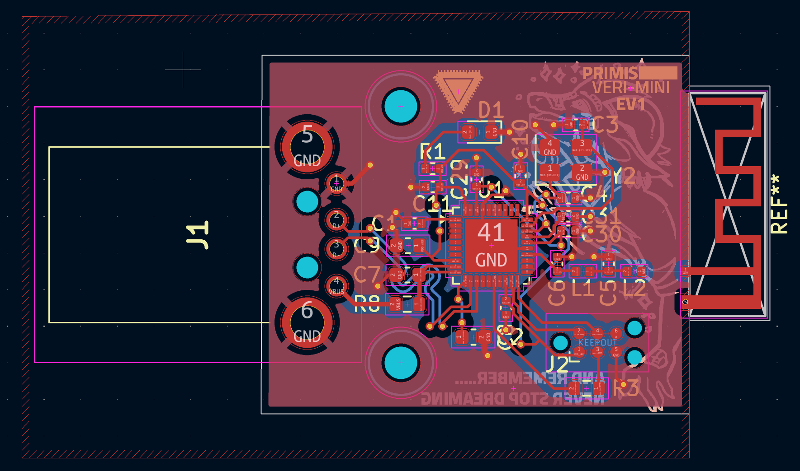

### Status

| 🛑R&D | hw: EV1 | 
| -------- | ------- |

> This accessory is experimental. The latest hardware revision is either untested, incomplete, or broken. Capabilities are unproven. Form factor and design requirements may change entirely. Intended for use by hardware contributors.

# VERI-MINI
The general purpose dongle for the Steam Frame but smaller.

  

### Schematics

  

### PCB

  

