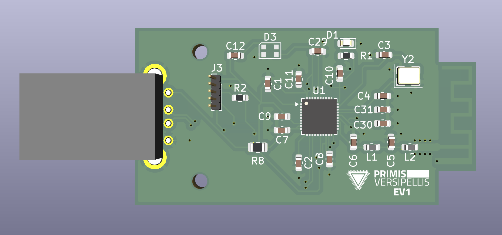
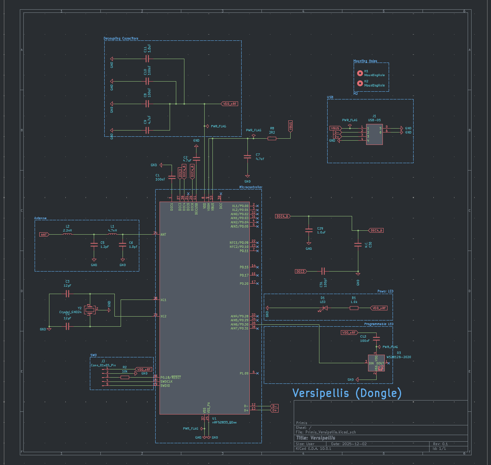
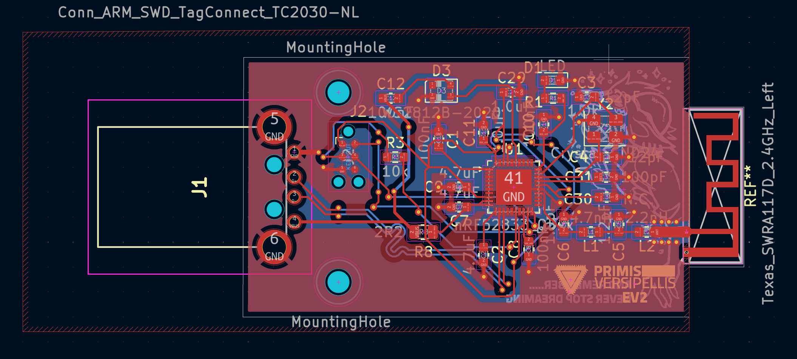
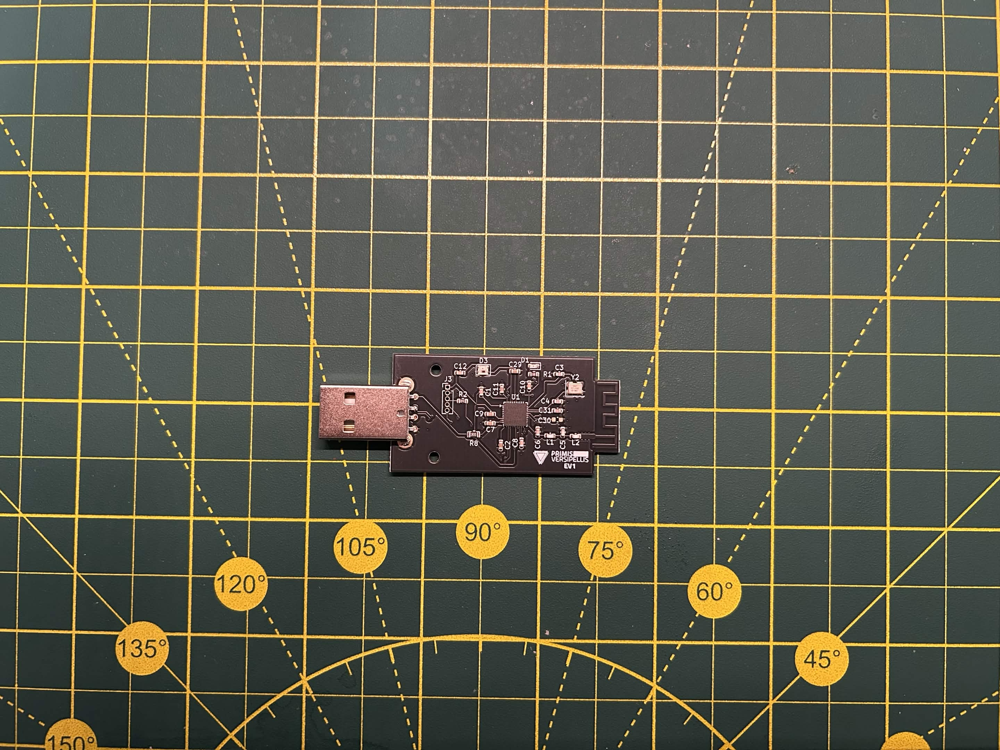

### Status

| 🟠WIP | hw: EV2 | 
| -------- | ------- |

> The current hardware revision has been tested and is fully capable of meeting established design requirements. Firmware and/or software are in active development. Future hardware revisions may still follow if oversights or improvements are discovered. Intended for use by software contributors.

# Versipellis
The general purpose dongle for the Steam Frame.

## Current Issues
The current version works but I made some mistakes on the clock speeds for the chip. This doesnt seem to effect perforamnce of chip any but Im not sure how it would affect the life time of the chip. Will fix in a future version.

  

### Schematics

  

### PCB

  

### EV1

  

### EV2

  

